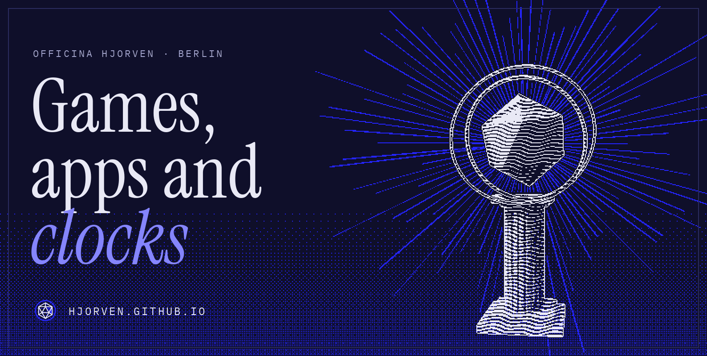
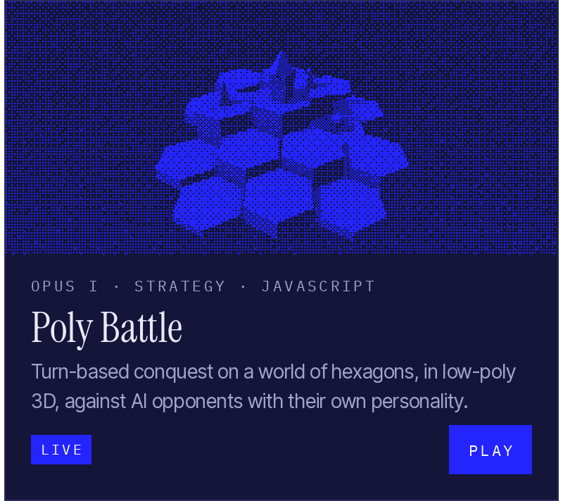
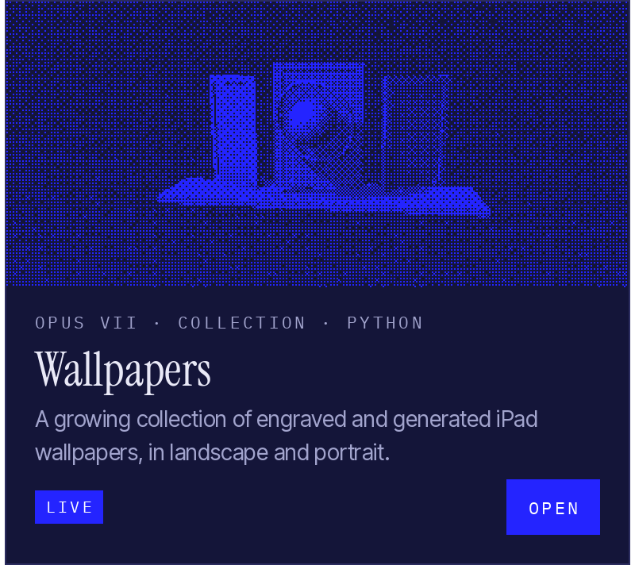
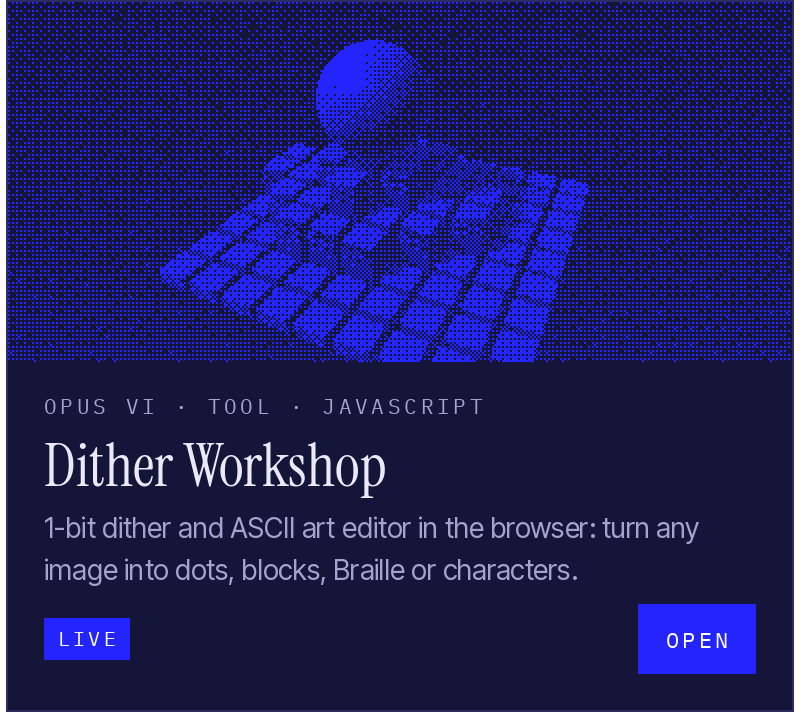
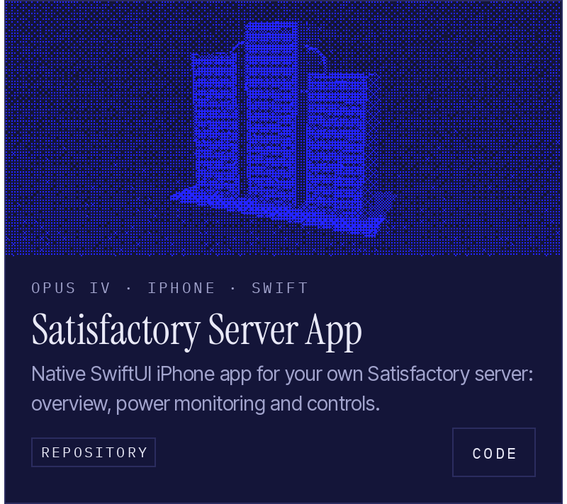
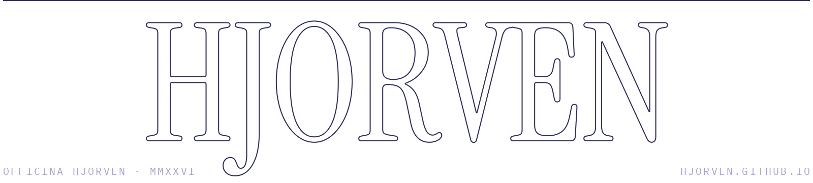

<!--
  Profil im Stil von hjorven.github.io. Die Grafiken in assets/ baut tools/build.py aus dem Portfolio-Repo:
      python3 tools/build.py ../hjorven.github.io
  Die Texte der Karten stehen oben in tools/build.py (OPERA), die Tabelle unten wird von Hand gepflegt.
  Wichtig: Zwischen den vier Karten darf kein Leerraum stehen, deshalb liegen die Zeilenumbrüche innerhalb der Tags.
-->

  <a href="https://hjorven.github.io/"><picture><source
    media="(prefers-color-scheme: dark)" srcset="assets/hero-dark.gif"><source
    media="(prefers-color-scheme: light)" srcset="assets/hero-light.gif"></picture></a>

  I build browser games, websites and apps for iPhone and Android. 
  Most of it runs right in your browser, and the <a href="https://hjorven.github.io/">portfolio</a> has the commands to build each project yourself.

  <a href="https://github.com/hjorven?tab=repositories"><picture><source
    media="(prefers-color-scheme: dark)" srcset="assets/head-featured-dark.png"><source
    media="(prefers-color-scheme: light)" srcset="assets/head-featured-light.png"></picture></a>

  <a href="https://hjorven.github.io/Poly-battle-web/"><picture><source
    media="(prefers-color-scheme: dark)" srcset="assets/opus-poly-battle-dark.png"><source
    media="(prefers-color-scheme: light)" srcset="assets/opus-poly-battle-light.png"></picture></a><a
    href="https://hjorven.github.io/wallpapers/"><picture><source
    media="(prefers-color-scheme: dark)" srcset="assets/opus-wallpapers-dark.png"><source
    media="(prefers-color-scheme: light)" srcset="assets/opus-wallpapers-light.png"></picture></a><a
    href="https://hjorven.github.io/dither-werkstatt/"><picture><source
    media="(prefers-color-scheme: dark)" srcset="assets/opus-dither-workshop-dark.png"><source
    media="(prefers-color-scheme: light)" srcset="assets/opus-dither-workshop-light.png"></picture></a><a
    href="https://github.com/hjorven/Satisfactory-Server-App"><picture><source
    media="(prefers-color-scheme: dark)" srcset="assets/opus-satisfactory-dark.png"><source
    media="(prefers-color-scheme: light)" srcset="assets/opus-satisfactory-light.png"></picture></a>

  <a href="https://hjorven.github.io/#index"><picture><source
    media="(prefers-color-scheme: dark)" srcset="assets/head-index-dark.png"><source
    media="(prefers-color-scheme: light)" srcset="assets/head-index-light.png"></picture></a>

| | Opus | | Language | |
|--:|:--|:--|:--|:--|
| I | **Poly Battle** | Turn-based hex strategy in low-poly 3D | JavaScript | [Play](https://hjorven.github.io/Poly-battle-web/)&nbsp;·&nbsp;[Code](https://github.com/hjorven/Poly-battle-web) |
| II | **Binary Clock** | Time in ones and zeros | HTML | [Open](https://hjorven.github.io/binaeruhr/)&nbsp;·&nbsp;[Code](https://github.com/hjorven/binaeruhr) |
| III | **Du bleibst** | Full-screen scrolling text | HTML | [Open](https://hjorven.github.io/Du-bleibst/)&nbsp;·&nbsp;[Code](https://github.com/hjorven/Du-bleibst) |
| IV | **Satisfactory Server App** | iPhone app for your own server | Swift | [Code](https://github.com/hjorven/Satisfactory-Server-App) |
| V | **Listening Stats** | Android app for Last.fm and stats.fm | Kotlin | [Code](https://github.com/hjorven/listening-stats-android-concept) |
| VI | **Dither Workshop** | 1-bit dither and ASCII art editor | JavaScript | [Open](https://hjorven.github.io/dither-werkstatt/)&nbsp;·&nbsp;[Code](https://github.com/hjorven/dither-werkstatt) |
| VII | **Wallpapers** | Engraved and generated iPad wallpapers | Python | [Open](https://hjorven.github.io/wallpapers/)&nbsp;·&nbsp;[Code](https://github.com/hjorven/wallpapers) |

  <a href="https://hjorven.github.io/"><picture><source
    media="(prefers-color-scheme: dark)" srcset="assets/foot-dark.png"><source
    media="(prefers-color-scheme: light)" srcset="assets/foot-light.png"></picture></a>

